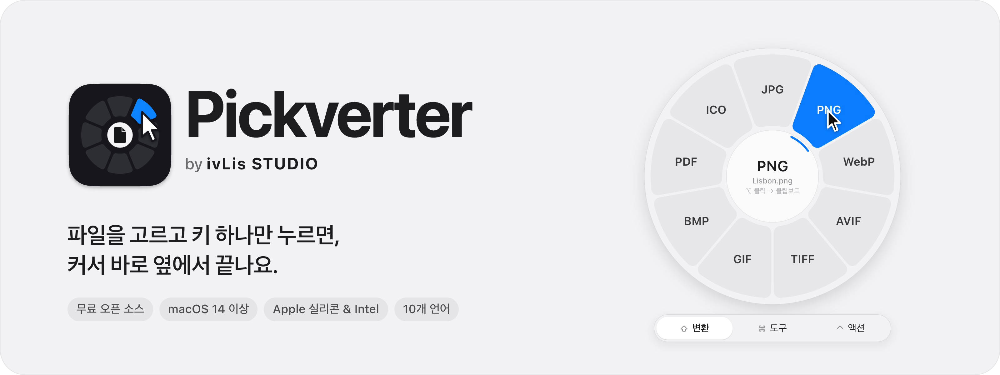
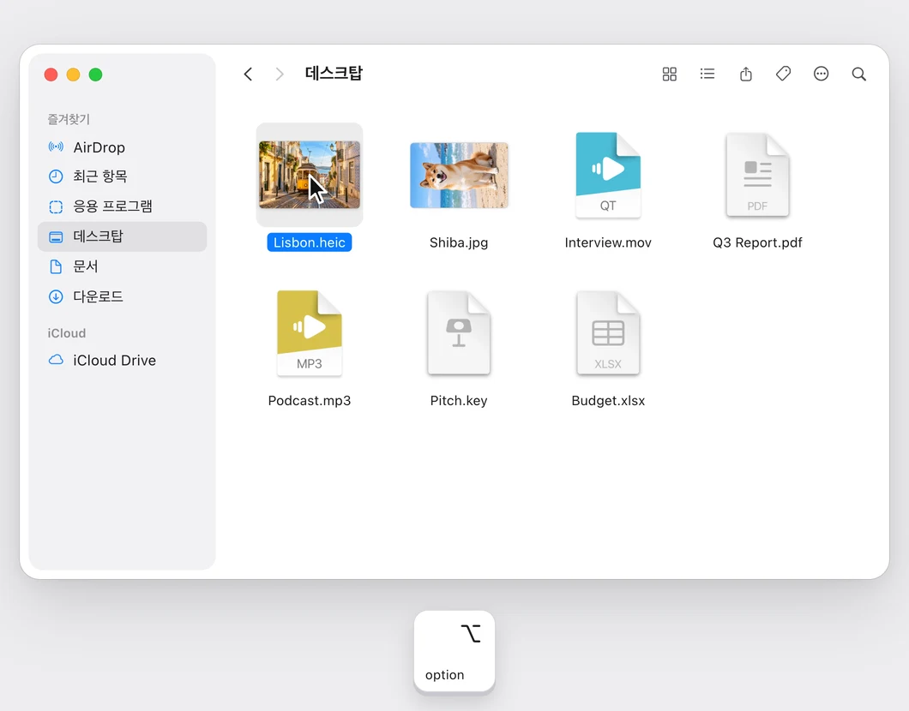
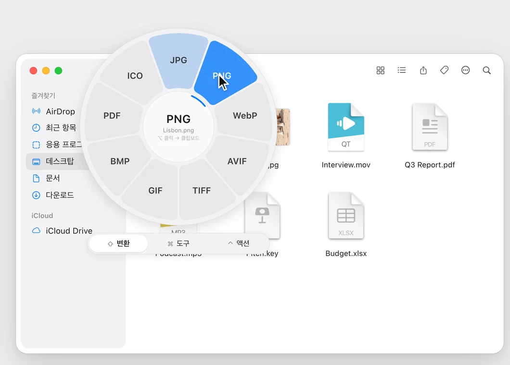
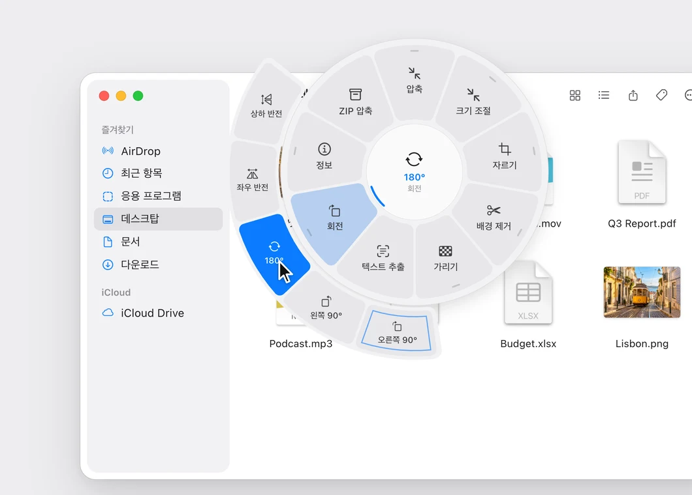
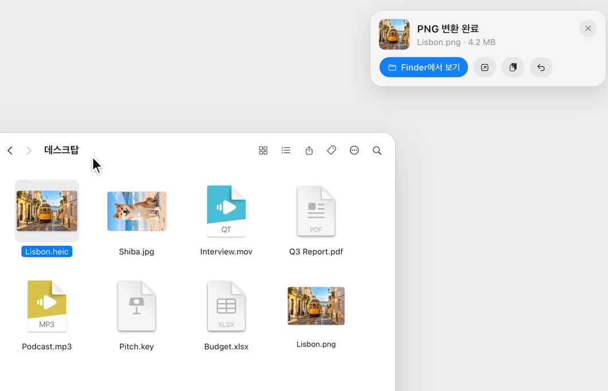
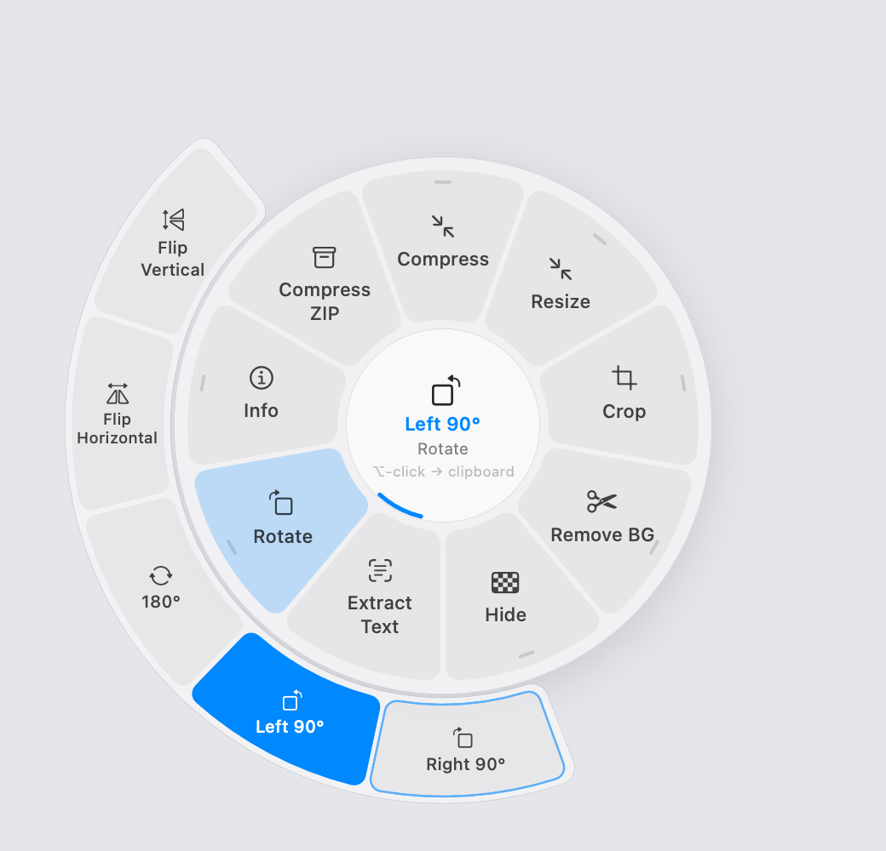
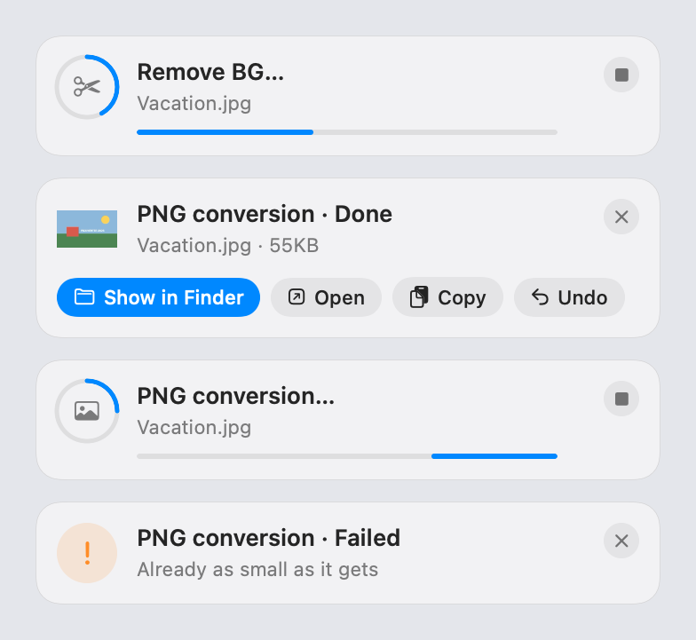
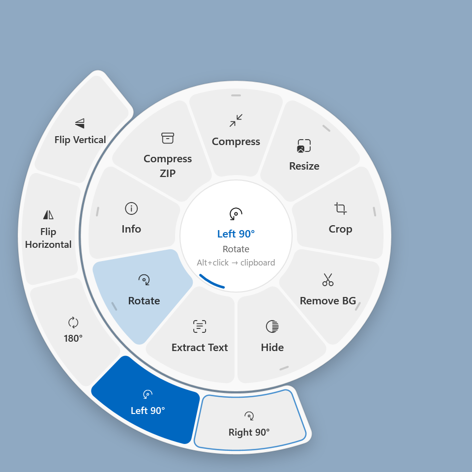
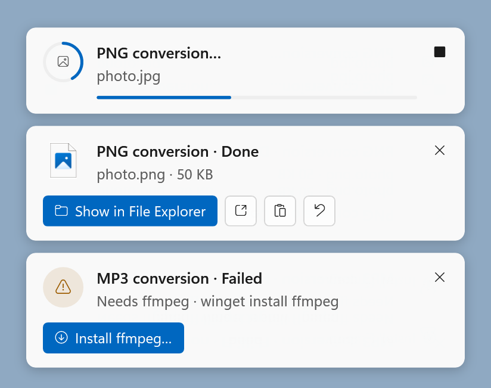

<p align="center">
  <a href="https://ivlis-studio.github.io/pickverter/?lang=ko">
    <picture>
      <source media="(prefers-color-scheme: dark)" srcset="docs/readme/banner-ko-dark.png">
      
    </picture>
  </a>
</p>

<p align="center">
  <a href="https://github.com/ivLis-Studio/pickverter/releases/latest"></a>
  <a href="https://github.com/ivLis-Studio/pickverter/releases"></a>
  
  
  <a href="LICENSE"></a>
  <a href="https://github.com/ivLis-Studio/pickverter/actions/workflows/macos-ci.yml"></a>
  <a href="https://github.com/ivLis-Studio/pickverter/actions/workflows/windows-ci.yml"></a>
</p>

<p align="center"><b>Mac·Windows용 무료 앱</b> — 계정도, 구독도, 광고도 없어요.</p>

<p align="center">
  <a href="https://github.com/ivLis-Studio/pickverter/releases/latest"><b>다운로드</b></a> ·
  <a href="https://ivlis-studio.github.io/pickverter/?lang=ko"><b>웹사이트</b></a> ·
  <a href="#설치">설치</a> ·
  <a href="windows/README.md">Windows</a> ·
  <a href="macos/CHANGELOG.md">변경 내역</a> ·
  <a href="README.md">English</a>
</p>

<!-- 영상은 GitHub 첨부 파일이라 README에서 바로 재생돼요. 원본: promo/ -->
https://github.com/user-attachments/assets/f2b6a1cc-2df3-4cb4-a95c-205937050f43

<p align="center"><sub>35초 · 소리를 켜고 보세요 · <a href="#windows에서는">Windows 영상 보기 ↓</a></sub></p>

## 사용법

<table>
  <tr>
    <td width="50%" valign="top"><br><b>1 · 파일을 고르고 ⌥ 톡</b><br>Finder에서 파일을 고르고 Option을 톡 — 파일을 ⌥-클릭하거나, 드래그 중에 ⇧ ⌘ ⌃를 눌러도 돼요.</td>
    <td width="50%" valign="top"><br><b>2 · 커서 바로 옆에 휠이 열려요</b><br>칸을 가리키세요. 가운데에 클릭하면 무엇이 실행될지 항상 보여줘요.</td>
  </tr>
  <tr>
    <td width="50%" valign="top"><br><b>3 · 올려 두면 옵션이 펼쳐져요</b><br>옵션이 있는 칸은 바깥 링으로 펼쳐져요 — 회전 방향, 크기, 품질까지.</td>
    <td width="50%" valign="top"><br><b>4 · 그 자리에서 완료</b><br>결과는 원본 옆이나 클립보드로 가고, 카드에서 보기·열기·복사·되돌리기를 바로 할 수 있어요.</td>
  </tr>
</table>

## 기능

<table>
  <tr>
    <td valign="top" width="33%"><b>⇧ 변환</b><br><sub>이미지 · 동영상 · 오디오 · PDF · 문서 · 한글(HWP·HWPX) · EPUB · 오피스·iWork · 표 · 자막 · 압축 파일</sub></td>
    <td valign="top" width="33%"><b>⌘ 도구</b><br><sub>배경 제거 · 얼굴·글자 가리기 · 압축 · 크기 조절 · 자르기 · OCR · 회전 · 구간 자르기 · 나누기·합치기 · PDF 페이지 · 암호 · 정보</sub></td>
    <td valign="top" width="33%"><b>⌃ 액션</b><br><sub>AirDrop · 터미널 · 코드 편집기 · 경로 복사 · 파일 복사 · 이동 · 띄워두기 · 공유 · 체크섬</sub></td>
  </tr>
</table>

- **변환** 이미지(JPG·PNG·HEIC·WebP·AVIF·TIFF·GIF·BMP·PDF·ICO), 동영상(MP4·MOV·WebM·MKV·GIF·MP3·M4A·WAV),
  오디오(MP3·M4A·WAV·FLAC·AIFF·OGG·Opus), PDF(PNG·JPG·TXT·MD·DOCX·RTF·HTML), 문서(PDF·DOCX·RTF·TXT·MD·HTML·ODT·**EPUB**),
  **한글 HWP·HWPX**(PDF·DOCX·HWP ↔ HWPX·PNG·JPG·TXT·MD·HTML — 암호 문서와 배포용 문서도),
  엑셀·Numbers·Pages·Keynote·파워포인트, 표(CSV·TSV·JSON·MD·HTML), 자막(SRT·VTT·TXT), 압축(ZIP·TAR.GZ)
- **편집 창** 동영상·오디오 구간 자르기, 비율 프리셋이 있는 자르기, 가리기(모자이크·흐림·채우기 — 얼굴과 글자 자동 찾기),
  끌어서 정리하는 PDF 페이지, 사진·PDF·미디어 정보 편집(사진은 가능하면 재압축 없이)
- **도구** 압축, 크기 조절, 배경 제거, 텍스트 추출(OCR), 회전·반전, 콜라주, 그림책 EPUB · 동영상 압축·해상도·속도·음소거·스냅샷·나누기·합치기 ·
  오디오 음량 맞추기·무음 자르기·모노·시각화 영상 · PDF 합치기·나누기·쪽 추출·역순·빈 쪽 지우기·암호 · 오피스/iWork 파일 속 이미지 꺼내기 · ZIP/TAR.GZ
- **액션** AirDrop, 터미널·코드 편집기로 열기, 경로 복사(전체·~·이름·셸 따옴표), 클립보드, 최근 폴더로 이동·복사, 항상 위 미리보기, 공유, 체크섬(SHA-256·SHA-1·MD5)

**결과는 원하는 곳으로** — 파일로, 클립보드로, 둘 다, 또는 매번 묻기(설정 › 일반).
⌥-클릭이나 ⌘C는 이번 결과만 클립보드로, ⌘S는 파일로 보내요. 원본은 절대 덮어쓰지 않아요.

**내 맘대로** — 설정 › 휠에서 파일 종류마다 링 구성을 미리보기로 보며 바꿀 수 있어요. 칸을 끌어서 순서를 바꾸고, 안 쓰는 칸은
빼고, 옵션 하나를 칸으로 꺼내거나(회전 · 왼쪽 90°) 다른 링의 칸을 가져오세요(압축 옆에 AirDrop). 다 되면 모든 파일 종류에
한 번에 적용할 수도 있어요. 휠에서 칸을 우클릭해도 바로 할 수 있어요.

<p align="center">
  
  
</p>

### Windows에서는

같은 휠을 Windows 방식으로 써요. 파일 탐색기(또는 바탕 화면)에서 파일을 고르고 **Alt 톡**, 파일을 **Alt+클릭**,
파일을 끄는 동안 **Shift / Ctrl / Alt 톡**. Enter로 실행, Esc로 닫기, Ctrl+C / Ctrl+S로 이번 결과만 클립보드나 파일로 보내요.
AirDrop 자리는 Windows 공유가, 실행 취소는 휴지통이 맡고, 강조 색과 라이트·다크 모드를 그대로 따라가요.

<!-- Windows판 영상도 GitHub 첨부 파일이에요. 원본: promo/win.html -->
https://github.com/user-attachments/assets/49415c57-42f0-4318-bb77-774c99dfaae4

<p align="center"><sub>Windows용 Pickverter · 35초 · 소리를 켜고 보세요</sub></p>

<p align="center">
  
  
</p>

<details>
<summary><b>키보드</b></summary>

| 동작 | |
| --- | --- |
| Finder에서 파일 선택 → **⌥ 톡** | 선택한 파일의 휠 |
| 파일을 **⌥-클릭** | 그 파일의 휠 |
| 파일을 드래그하는 동안 **⇧ / ⌘ / ⌃ 톡** | 변환 / 도구 / 액션 링 — 칸 위에 놓으면 실행 |
| ← → · 1–0 | 휠 이동 · 번호로 칸 실행 |
| ↑ ↓ 또는 바깥으로 이동 | 바깥 링의 옵션 |
| `png`, `mp3`… 타이핑 | 그 형식으로 바로 이동 |
| Tab 또는 ⇧ ⌘ ⌃ | 링 전환 |
| ↩︎ · esc | 실행 · 닫기 |

</details>

## 설치

### Mac

1. [Releases](https://github.com/ivLis-Studio/pickverter/releases/latest)에서 **Pickverter-x.y.z.dmg**를 내려받아 Pickverter를 응용 프로그램 폴더로 끌어 놓으세요.
2. 아직 공증(notarization)을 받지 않아 처음 한 번은 **시스템 설정 › 개인정보 보호 및 보안**에서 **그래도 열기**를 눌러야 해요(또는 앱 우클릭 › 열기).
3. **손쉬운 사용**(⌥ 탭·드래그 감지)과 **Finder 제어**(선택한 파일 읽기)를 허용하세요. 첫 화면이 차례대로 안내해요.
   이어서 **파일 접근**도 미리 허용할 수 있어요. **전체 디스크 접근 권한**(권장 — 어떤 폴더·드라이브도 다시 묻지 않음)을 켜거나,
   데스크탑·문서·다운로드·iCloud Drive만 허용하세요. 미리 해 두면 작업 도중에 macOS 권한 창이 끼어들지 않아요.
4. 선택: [ffmpeg](https://ffmpeg.org)이 있으면 동영상·오디오 형식이 더 늘어나요. 첫 화면이나 설정에서, 또는 그 형식이 처음 필요할 때
   클릭 한 번으로 Pickverter가 직접 내려받아요(`brew install ffmpeg`로 설치해도 돼요).
   한글 문서(HWP·HWPX)는 오픈소스 HWP 엔진 [rhwp](https://github.com/edwardkim/rhwp)로 변환해요. 처음 변환할 때(또는 설정 › 연동에서)
   Pickverter가 직접 내려받아요(약 13MB).
   Pages·Keynote·Numbers나 LibreOffice가 설치되어 있으면 오피스/iWork 문서를 고품질로 내보낼 수 있어요.

macOS 14 이상, Apple 실리콘과 Intel 모두 지원해요.

### Windows

1. [Releases](https://github.com/ivLis-Studio/pickverter/releases/latest)에서 **Pickverter-x.y.z-win-x64-setup.exe**(스냅드래곤 PC는 **win-arm64**)를 내려받아 실행하세요.
   내 계정에만 설치돼서 관리자 권한이 필요 없어요.
2. 아직 코드 서명이 없어 **"Windows의 PC 보호"** 창이 뜰 수 있어요. **추가 정보 › 실행**을 누르세요.
3. 첫 화면이 Windows 보안의 **제어된 폴더 액세스**를 확인하고(켜져 있으면 Pickverter를 허용하도록 도와줘요), 클릭 한 번으로 **ffmpeg**을 내려받고,
   Windows 시작 시 실행을 켜 줘요. 그 밖에는 권한이 필요 없어요.
   한글 문서 엔진 rhwp는 HWP·HWPX 파일을 처음 변환할 때 알아서 내려받아요.

Windows 10 2004 이상 또는 Windows 11(x64·Arm64)에서 동작해요. Pickverter는 알림 영역에 머물러요.
키 배치·엔진·빌드 방법은 [windows/README.md](windows/README.md)에 있어요.

### 업데이트

하루에 한 번쯤 이 저장소의 릴리스를 확인하고, 클릭 한 번으로(또는 백그라운드에서 받아 두었다가 다음 재시작 때) 설치해요 — 설정 › 업데이트.
설치 전에 Ed25519 서명, 크기와 SHA-256, 번들 ID, 코드 서명을 모두 검증합니다.

지금은 Apple Developer ID 없이 애드혹 서명으로 배포하기 때문에, macOS가 새 버전을 다른 앱으로 보고 업데이트 후 권한(손쉬운 사용·Finder 제어·파일 접근)을 한 번 더 요청해요.
Pickverter가 예전 항목을 정리하고 첫 화면을 다시 열어 바로 켤 수 있게 해 줘요.

Windows 앱은 같은 릴리스의 `update-windows.json`을 읽고 같은 Ed25519 서명·크기·SHA-256을 확인한 뒤, 자기 폴더를 바꿔 끼우고 다시 실행해요. 관리자 권한 창은 뜨지 않아요.

### 개인정보

파일은 내 컴퓨터 밖으로 나가지 않아요. 네트워크 요청은 github.com의 업데이트 확인 하나뿐이고, 끌 수 있어요
(Windows에서 배경 제거를 처음 쓸 때 모델을 한 번 내려받는 것 말고는요).

## 언어

English · 한국어 · 日本語 · 简体中文 · 繁體中文 · Español · Français · Deutsch · Русский · Português (Brasil).
설정 › 일반에서 언제든 바꿀 수 있어요. 문구는 모두 `macos/Resources/i18n.json`에 있고, Windows 앱만의 표현은
`windows/Resources/i18n.windows.json`에 있어요. 번역 수정 환영합니다.

## 직접 빌드하기

Mac 앱은 `macos/` 폴더에 있어요.

```sh
cd macos
scripts/build-app.sh            # release 빌드 → build/Pickverter.app
scripts/build-app.sh debug --run
scripts/test.sh                 # 번역 검사, 휠 자체 테스트, 샘플 파일로 엔진 약 60가지 실행
```

Xcode 프로젝트 없이 `swiftc`로 바로 빌드해요. Command Line Tools만 있으면 SwiftUI 매크로가 필요 없는 SDK를 자동으로 골라요.
Xcode나 SwiftPM을 쓴다면 `macos/Package.swift`를 여세요.

로컬 빌드는 애드혹 서명이라, 다시 빌드한 뒤에는 손쉬운 사용 목록에서 Pickverter를 지우고 다시 추가해야 할 수 있어요.
고정 인증서가 있다면 `PICKVERTER_SIGN_IDENTITY`로 서명하세요.

개발용 명령(`macos/`에서 실행): `build/Pickverter.app/Contents/MacOS/Pickverter cli …` — `list`, `run <option-id> <파일>`, `snapshot`,
`editor-snapshot`, `selftest`, `fixtures`, `inspect`. 편집 창의 답은 환경 변수로 넣을 수 있어서(`PICKVERTER_EDITOR_CROP='{"rect":…}'`) 테스트는 창 없이 돌아가요.

Windows 앱은 `windows/` 폴더에 있어요(.NET 10, WPF).

```powershell
cd windows
scripts/build.ps1 -Run          # debug 빌드 후 실행
scripts/test.ps1                # 번역 검사, 단위 테스트, 아이콘 검사, Windows 자체 테스트
```

코어와 테스트는 Mac에서도 빌드·실행돼요(`dotnet test --project tests/Pickverter.Core.Tests/Pickverter.Core.Tests.csproj`).
CI가 Windows 러너에서 모든 창을 6개 언어·두 테마로 렌더링하고, 파일 탐색기를 실제로 조작해 처음부터 끝까지 확인해요.

## 릴리스하기

1. `macos/CHANGELOG.md`와 `windows/CHANGELOG.md`에 `## [x.y.z]` 섹션을 추가하세요. 릴리스 노트와 업데이트 창의 내용이 돼요.
2. 태그를 푸시하세요: `git tag vx.y.z && git push origin vx.y.z`. **macOS Release** 워크플로가 유니버설 앱·DMG·ZIP·서명된 `update.json`을,
   **Windows Release** 워크플로가 x64·Arm64 설치 파일·포터블 ZIP·서명된 `update-windows.json`을 만들어 같은 GitHub 릴리스에 올려요. 먼저 끝난 쪽이 릴리스를 만들어요.
   (로컬에서는 `macos/scripts/release.sh x.y.z --publish`, `windows/scripts/release.ps1 -Version x.y.z -Publish`)

업데이트 서명 키는 저장소 시크릿 `PICKVERTER_UPDATE_KEY`이고, 공개 키는 `macos/Resources/Info.plist`의 `PVUpdatePublicKey`와
`windows/src/Pickverter.Core/Pickverter.Core.csproj`의 `PickverterUpdateKey`예요.
이 키로 서명한 업데이트만 설치되니 꼭 백업해 두세요. Developer ID 빌드용 선택 시크릿: `MACOS_CERT_P12`, `MACOS_CERT_PASSWORD`, `MACOS_SIGN_IDENTITY`,
공증용: `APPLE_ID`, `APPLE_TEAM_ID`, `APPLE_APP_PASSWORD`.

## 저장소 구성

- [`macos/`](macos) — Mac 앱: Swift 소스, 리소스, 빌드·테스트·릴리스 스크립트, 변경 내역
- [`windows/`](windows) — Windows 앱: .NET 10 / WPF 소스, 테스트, Inno Setup 설치 프로그램, 빌드·테스트·릴리스 스크립트, 변경 내역
- [`website/`](website) — 소개 사이트 [ivlis-studio.github.io/pickverter](https://ivlis-studio.github.io/pickverter/?lang=ko). GitHub Pages가 `website/public/`을 게시해요
- [`promo/`](promo) — 소개 영상과 README 이미지
- [`docs/`](docs) — 이 README에 쓰는 이미지

`macos/Sources/Pickverter/` 안에는:

- `Input/` 이벤트 탭(보조 키 탭, ⌥-클릭, 드래그), Finder 선택 읽기
- `Wheel/` 휠 패널, 바깥 옵션 링, 드롭 대상, 렌더링
- `Core/` 옵션 모델, 링별 항목, 휠 꾸미기, 작업 대기열, 현지화
- `Engines/` 이미지(ImageIO, Vision), 미디어(ffmpeg, AVFoundation), PDF(PDFKit), 문서, 한글(rhwp), EPUB, 오피스/iWork, 데이터, 압축
- `UI/` 결과 카드, 편집 창, 설정, 메뉴 막대, 첫 화면, 업데이트 창
- `App/` 앱 생명주기, 환경설정, 업데이터, CLI

## 라이선스

Pickverter는 무료예요. 내려받아 마음껏 쓰세요.

[MIT](LICENSE) © ivLis Studio. 서드파티 구성 요소는 각자의 라이선스를 따라요. 한글 문서 변환에 쓰는
[rhwp](https://github.com/edwardkim/rhwp)(Edward Kim, MIT)와 요청할 때 내려받는 ffmpeg이 대표적이에요.
