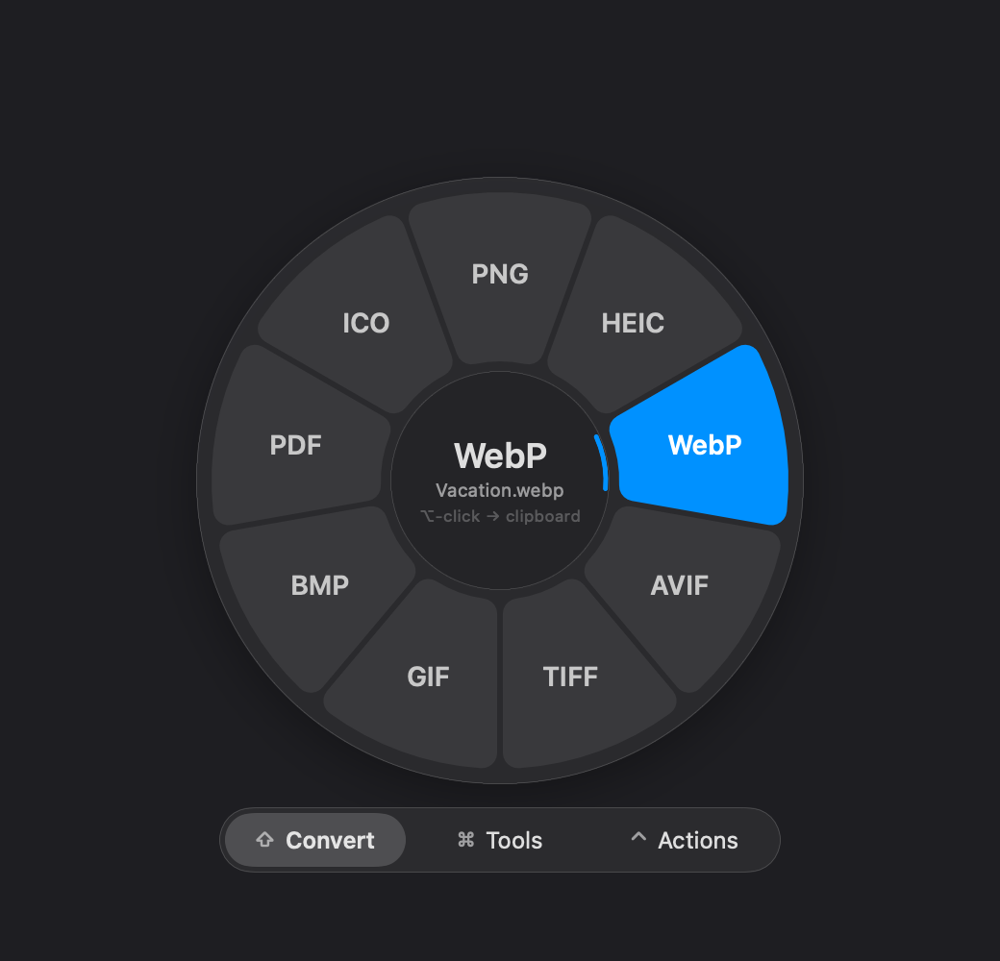
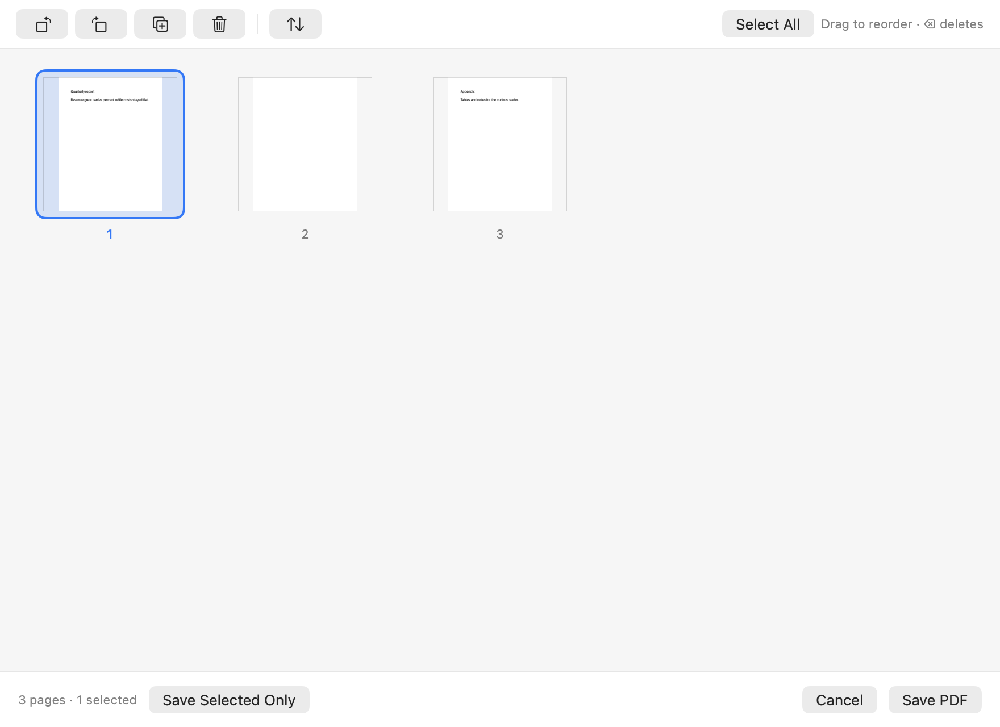

# Pickverter

Finder에서 파일을 고르고 키 하나만 누르면, 커서 바로 옆에서 변환·편집·공유를 끝내는 macOS 앱입니다.
모든 처리는 Mac 안에서만 이뤄지고 어디에도 올라가지 않아요.

<p align="center">
  
  
</p>

[English README](README.md) · [다운로드](https://github.com/ivLis-Studio/pickverter/releases/latest) · [변경 내역](CHANGELOG.md)

## 휠 여는 법

| 제스처 | |
| --- | --- |
| Finder에서 파일 선택 → **⌥ 탭** | 선택한 파일로 휠 열기 |
| 파일을 **⌥ 누른 채 클릭** | 그 파일로 바로 휠 열기 |
| 파일을 끄는 중 **⇧ / ⌘ / ⌃ 탭** | 변환 / 도구 / 액션 링 → 칸 위에 놓기 |

휠 안에서: 마우스 방향이나 ← → 로 칸 고르기(숫자 1–0은 바로 실행), ↑ ↓ 또는 바깥쪽으로 옮겨 세부 옵션 고르기,
형식 이름(png, mp3…) 입력으로 이동, Tab 또는 ⇧ ⌘ ⌃ 로 링 전환, ↩︎ 실행, esc 닫기.
**⌥ 클릭 / ⌘C** 는 이번 결과만 클립보드로, **⌘S** 는 파일로 보내요.

**나만의 휠** — 칸을 우클릭하면 숨기기, 앞뒤로 옮기기, 옵션을 메인 링에 고정하기, 클릭했을 때 실행할 옵션 정하기를 할 수 있어요.
칸마다 마지막으로 쓴 옵션을 기억할 수도 있고, 휠 가운데에는 클릭하면 무엇이 실행되는지 항상 보여 줘요.

## 할 수 있는 것

- **변환** 이미지(JPG·PNG·HEIC·WebP·AVIF·TIFF·GIF·BMP·PDF·ICO), 동영상(MP4·MOV·WebM·MKV·GIF·MP3·M4A·WAV),
  오디오(MP3·M4A·WAV·FLAC·AIFF·OGG·Opus), PDF(PNG·JPG·TXT·MD·DOCX·RTF·HTML), 문서(PDF·DOCX·RTF·TXT·MD·HTML·ODT·**EPUB**),
  엑셀·Numbers·Pages·Keynote·파워포인트, 표(CSV·TSV·JSON·MD·HTML), 자막(SRT·VTT·TXT), 압축(ZIP·TAR.GZ)
- **편집 창** 동영상·오디오 구간 자르기, 비율 프리셋이 있는 자르기, 가리기(모자이크·흐림·채우기 — 얼굴과 글자 자동 찾기),
  끌어서 정리하는 PDF 페이지, 사진·PDF·미디어 정보 편집(사진은 가능하면 재압축 없이)
- **도구** 압축, 크기 조절, 배경 제거, 텍스트 추출(OCR), 회전·반전, 콜라주, 그림책 EPUB · 동영상 압축·해상도·속도·음소거·스냅샷·나누기·합치기 ·
  오디오 음량 맞추기·무음 자르기·모노·시각화 영상 · PDF 합치기·나누기·쪽 추출·역순·빈 쪽 지우기·암호 · 오피스/iWork 파일 속 이미지 꺼내기 · ZIP/TAR.GZ
- **액션** AirDrop, 터미널·코드 편집기로 열기, 경로 복사(전체·~·이름·셸 따옴표), 클립보드, 최근 폴더로 이동·복사, 항상 위 미리보기, 공유, 체크섬(SHA-256·SHA-1·MD5)

결과는 파일로, 클립보드로, 둘 다, 또는 매번 묻기 중에서 고를 수 있어요(설정 › 일반). 원본은 절대 덮어쓰지 않아요.
무거운 작업은 작은 대기열에서 차례를 기다려 Mac이 느려지지 않고, 결과 알림은 작업하던 화면의 원하는 모서리에 떠요.

<p align="center"></p>

## 설치

1. [Releases](https://github.com/ivLis-Studio/pickverter/releases/latest)에서 **Pickverter-x.y.z.dmg**를 내려받아 Pickverter를 응용 프로그램 폴더로 끌어 놓으세요.
2. 아직 공증(notarization)을 받지 않아 처음 한 번은 **시스템 설정 › 개인정보 보호 및 보안**에서 **그래도 열기**를 눌러야 해요(또는 앱 우클릭 › 열기).
3. **손쉬운 사용**(⌥ 탭·드래그 감지)과 **Finder 제어**(선택한 파일 읽기)를 허용하세요. 첫 화면이 차례대로 안내해요.
4. 선택: [ffmpeg](https://ffmpeg.org)이 있으면 동영상·오디오 형식이 더 늘어나요 — `brew install ffmpeg` (첫 화면에 설치 버튼이 있어요).
   Pages·Keynote·Numbers나 LibreOffice가 설치되어 있으면 오피스/iWork 문서를 고품질로 내보낼 수 있어요.

macOS 14 이상, Apple 실리콘과 Intel 모두 지원해요.

### 업데이트

하루에 한 번쯤 이 저장소의 릴리스를 확인하고, 클릭 한 번으로(또는 백그라운드에서 받아 두었다가 다음 재시작 때) 설치해요 — 설정 › 업데이트.
설치 전에 Ed25519 서명, 크기와 SHA-256, 번들 ID, 코드 서명을 모두 검증합니다.

지금은 Apple Developer ID 없이 애드혹 서명으로 배포하기 때문에, macOS가 새 버전을 다른 앱으로 보고 업데이트 후 손쉬운 사용 권한을 한 번 더 요청해요.
Pickverter가 예전 항목을 정리하고 어디서 다시 켜면 되는지 보여 줘요.

### 개인정보

파일은 Mac 밖으로 나가지 않아요. 네트워크 요청은 github.com의 업데이트 확인 하나뿐이고, 끌 수 있어요.

## 언어

English · 한국어 · 日本語 · 简体中文 · 繁體中文 · Español · Français · Deutsch · Русский · Português (Brasil).
설정 › 일반에서 언제든 바꿀 수 있어요. 문구는 모두 `Resources/i18n.json` 한 파일에 있어요. 번역 수정 환영합니다.

## 직접 빌드하기

```sh
scripts/build-app.sh            # release 빌드 → build/Pickverter.app
scripts/build-app.sh debug --run
scripts/test.sh                 # 번역 검사, 휠 자체 테스트, 샘플 파일로 엔진 약 60가지 실행
```

Xcode 프로젝트 없이 `swiftc`로 바로 빌드해요. Command Line Tools만 있으면 SwiftUI 매크로가 필요 없는 SDK를 자동으로 골라요.

로컬 빌드는 애드혹 서명이라, 다시 빌드한 뒤에는 손쉬운 사용 목록에서 Pickverter를 지우고 다시 추가해야 할 수 있어요.
고정 인증서가 있다면 `PICKVERTER_SIGN_IDENTITY`로 서명하세요.

개발용 명령: `build/Pickverter.app/Contents/MacOS/Pickverter cli …` — `list`, `run <option-id> <파일>`, `snapshot`, `editor-snapshot`,
`selftest`, `fixtures`, `inspect`. 편집 창의 답은 환경 변수로 넣을 수 있어서(`PICKVERTER_EDITOR_CROP='{"rect":…}'`) 테스트는 창 없이 돌아가요.

## 릴리스하기

1. `CHANGELOG.md`에 `## [x.y.z]` 섹션을 추가하세요. 릴리스 노트와 업데이트 창의 내용이 돼요.
2. 태그를 푸시하세요: `git tag vx.y.z && git push origin vx.y.z`. **Release** 워크플로가 테스트 → 유니버설 빌드 → DMG·ZIP·서명된 `update.json` 생성 → GitHub 릴리스 게시까지 해요.
   (로컬에서는 `scripts/release.sh x.y.z --publish`)

업데이트 서명 키는 저장소 시크릿 `PICKVERTER_UPDATE_KEY`이고, 공개 키는 `Resources/Info.plist`의 `PVUpdatePublicKey`예요.
이 키로 서명한 업데이트만 설치되니 꼭 백업해 두세요. Developer ID 빌드용 선택 시크릿: `MACOS_CERT_P12`, `MACOS_CERT_PASSWORD`, `MACOS_SIGN_IDENTITY`,
공증용: `APPLE_ID`, `APPLE_TEAM_ID`, `APPLE_APP_PASSWORD`.

## 라이선스

[MIT](LICENSE)

