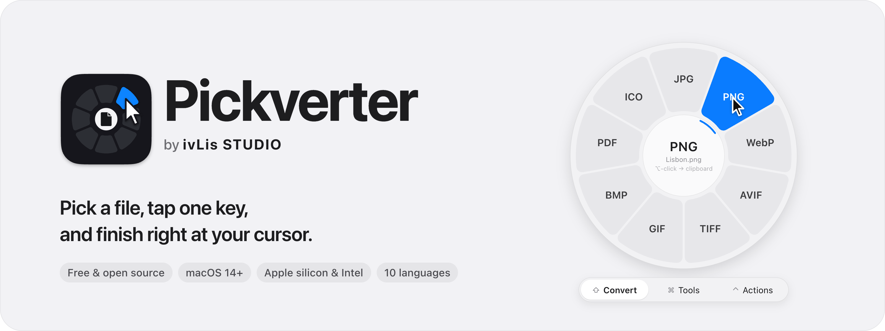
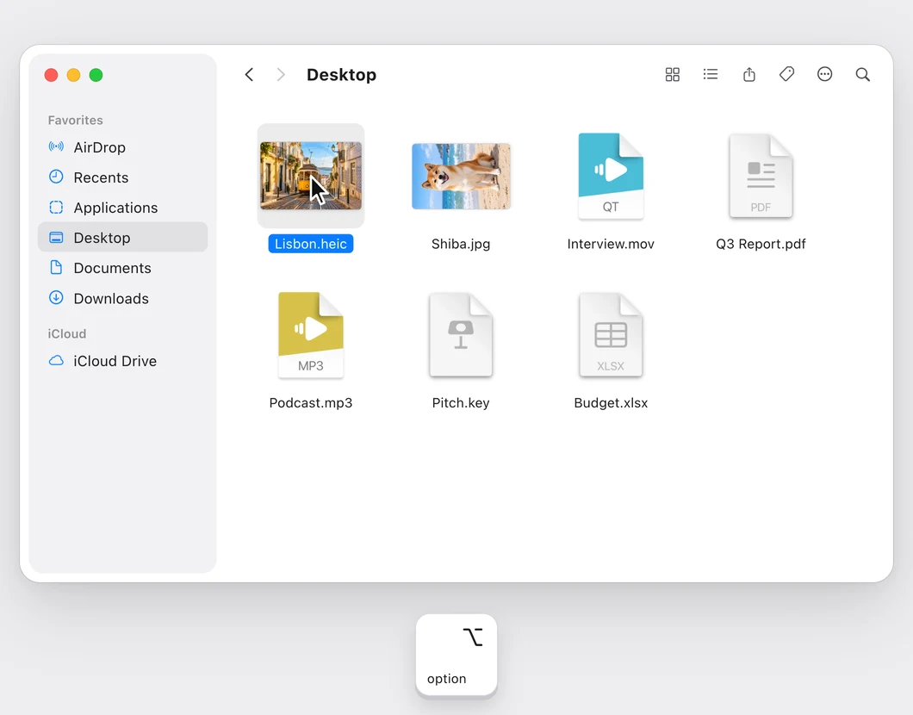
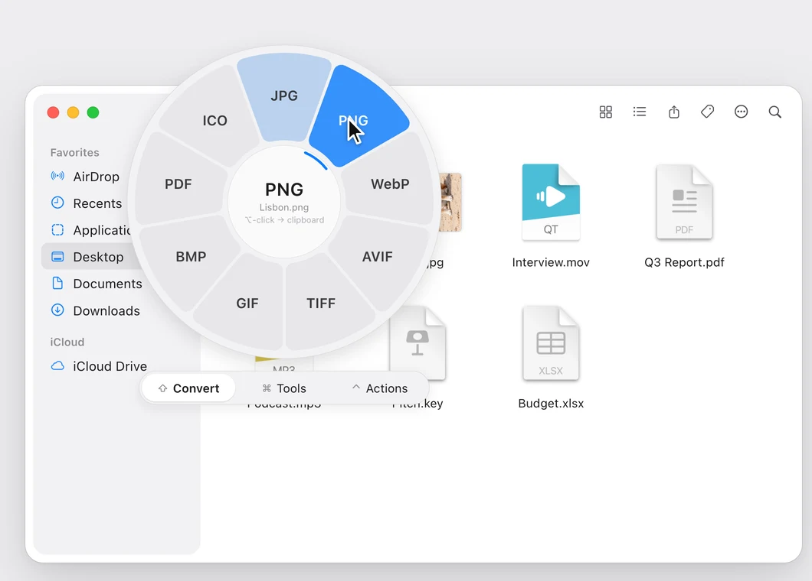
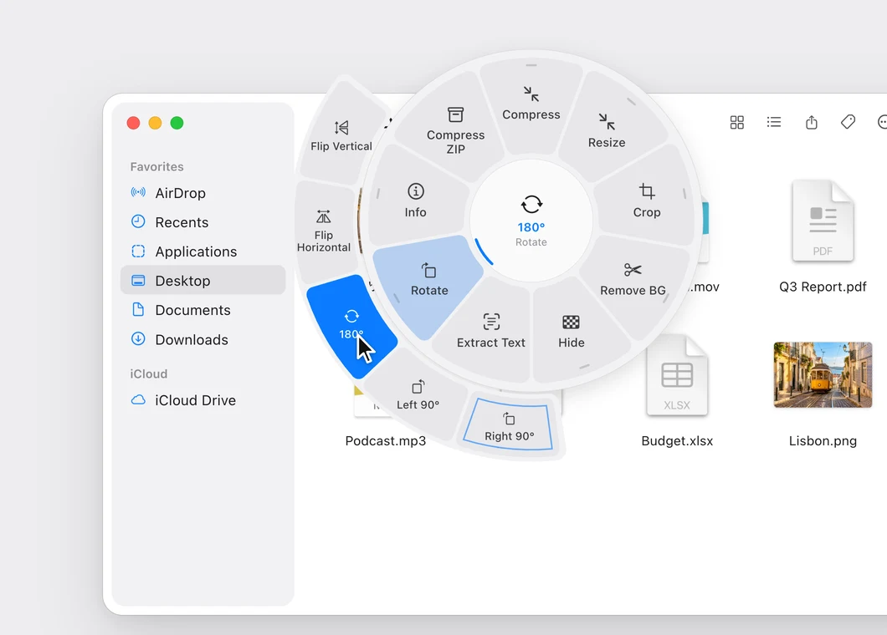
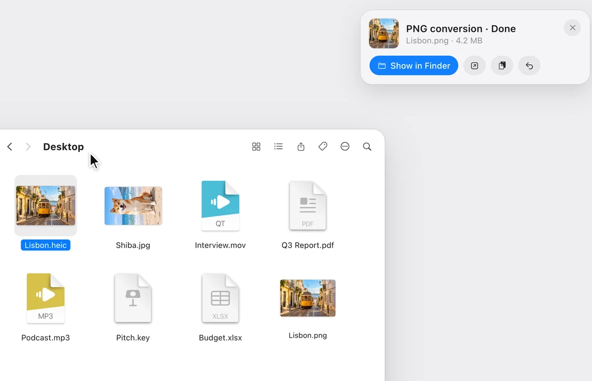

<p align="center">
  <a href="https://ivlis-studio.github.io/pickverter/">
    <picture>
      <source media="(prefers-color-scheme: dark)" srcset="docs/readme/banner-en-dark.png">
      
    </picture>
  </a>
</p>

<p align="center">
  <a href="https://github.com/ivLis-Studio/pickverter/releases/latest"></a>
  <a href="https://github.com/ivLis-Studio/pickverter/releases"></a>
  
  
  <a href="LICENSE"></a>
  <a href="https://github.com/ivLis-Studio/pickverter/actions/workflows/macos-ci.yml"></a>
  <a href="https://github.com/ivLis-Studio/pickverter/actions/workflows/windows-ci.yml"></a>
</p>

<p align="center"><b>Free for Mac and Windows</b> — no account, no subscription, no ads.</p>

<p align="center">
  <a href="https://github.com/ivLis-Studio/pickverter/releases/latest"><b>Download</b></a> ·
  <a href="https://ivlis-studio.github.io/pickverter/"><b>Website</b></a> ·
  <a href="#install">Install</a> ·
  <a href="windows/README.md">Windows</a> ·
  <a href="macos/CHANGELOG.md">Changelog</a> ·
  <a href="README.ko.md">한국어</a>
</p>

<!-- The film is a GitHub attachment, so it plays inline here. Source: promo/ -->
https://github.com/user-attachments/assets/dc4aa6e6-fdc4-4dd5-92ec-f9843eedd6e8

<p align="center"><sub>35 seconds · turn the sound on · <a href="#on-windows">Watch the Windows film ↓</a></sub></p>

## How it works

<table>
  <tr>
    <td width="50%" valign="top"><br><b>1 · Pick a file, tap ⌥</b><br>Select files in Finder and tap Option — or ⌥-click a file, or tap ⇧ ⌘ ⌃ while dragging.</td>
    <td width="50%" valign="top"><br><b>2 · The wheel opens at your cursor</b><br>Point at a slot. The center always shows what a click will do.</td>
  </tr>
  <tr>
    <td width="50%" valign="top"><br><b>3 · Hover to choose how</b><br>Slots with options fan them out — rotate direction, size, quality…</td>
    <td width="50%" valign="top"><br><b>4 · Done, right there</b><br>The result lands next to the original or on the clipboard, with a card to show, open, copy or undo.</td>
  </tr>
</table>

## Features

<table>
  <tr>
    <td valign="top" width="33%"><b>⇧ Convert</b><br><sub>Images · video · audio · PDF · documents · HWP &amp; HWPX · EPUB · Office &amp; iWork · tables · subtitles · archives</sub></td>
    <td valign="top" width="33%"><b>⌘ Tools</b><br><sub>Remove background · hide faces &amp; text · compress · resize · crop · OCR · rotate · trim · split &amp; join · PDF pages · lock · info</sub></td>
    <td valign="top" width="33%"><b>⌃ Actions</b><br><sub>AirDrop · Terminal · code editor · copy path · copy file · move · float · share · checksums</sub></td>
  </tr>
</table>

- **Convert** images (JPG, PNG, HEIC, WebP, AVIF, TIFF, GIF, BMP, PDF, ICO), video (MP4, MOV, WebM, MKV, GIF, MP3, M4A, WAV),
  audio (MP3, M4A, WAV, FLAC, AIFF, OGG, Opus), PDF (PNG, JPG, TXT, MD, DOCX, RTF, HTML), documents (PDF, DOCX, RTF, TXT, MD, HTML, ODT, **EPUB**),
  **HWP & HWPX** (PDF, DOCX, HWP ↔ HWPX, PNG, JPG, TXT, MD, HTML — password-protected and distribution documents too),
  Excel/Numbers/Pages/Keynote/PowerPoint, tables (CSV, TSV, JSON, MD, HTML), subtitles (SRT, VTT, TXT), archives (ZIP, TAR.GZ)
- **Edit** with small, focused editors: trim video and audio, crop with ratio presets, hide areas (mosaic, blur, fill — finds faces and text for you),
  organize PDF pages by drag and drop, edit photo/PDF/media info (losslessly for photos where possible)
- **Tools** compress, resize, remove background, extract text (OCR), rotate and flip, collage, picture-book EPUB · video compress, resolution,
  speed, mute, snapshot, split, join · audio loudness, silence trim, mono, visualizer video · PDF merge, split, extract pages, reverse,
  remove blank pages, lock · images and media out of Office/iWork files · ZIP / TAR.GZ
- **Actions** AirDrop, open in Terminal or your code editor, copy path (full, ~, name, shell-quoted), copy, move/copy to recent folders,
  float as an always-on-top preview, share, checksums (SHA-256, SHA-1, MD5)

**Results where you want them** — a file, the clipboard, both, or the wheel asks every time (Settings › General).
⌥-click / ⌘C sends one result to the clipboard, ⌘S to a file. Originals are never overwritten.

**Make it yours** — Settings › Wheel lays out each ring per file type with a live preview: drag slots into order, remove the ones
you never use, give an option its own slot (Rotate · Left) or bring in a slot from another ring (AirDrop next to Compress),
then use the layout for every file type. Right-click a slot in the wheel for the same moves on the spot.

<p align="center">
  
  
</p>

### On Windows

The same wheel, made for Windows: **tap Alt** with files selected in File Explorer or on the desktop, **Alt+click** a file,
or **tap Shift / Ctrl / Alt** while dragging. Enter runs, Esc closes, Ctrl+C / Ctrl+S send one result to the clipboard or a file.
Share takes AirDrop's place, Undo uses the Recycle Bin, and everything follows your accent color and light or dark mode.

<!-- The Windows cut of the film, also a GitHub attachment. Source: promo/win.html -->
https://github.com/user-attachments/assets/e47fc193-fc9c-48ff-b08b-e94a4da85e0c

<p align="center"><sub>Pickverter for Windows · 35 seconds · turn the sound on</sub></p>

<p align="center">
  
  
</p>

<details>
<summary><b>Keyboard</b></summary>

| Gesture | |
| --- | --- |
| Select files in Finder → **tap ⌥** | wheel for the selection |
| **⌥-click** a file | wheel for that file |
| While dragging files, **tap ⇧ / ⌘ / ⌃** | Convert / Tools / Actions ring — drop on a slot |
| ← → · 1–0 | move around the wheel · run a slot by number |
| ↑ ↓ or move outward | a slot's options on the outer ring |
| type `png`, `mp3`… | jump to a format |
| Tab or ⇧ ⌘ ⌃ | switch rings |
| ↩︎ · esc | run · close |

</details>

## Install

### Mac

1. Download **Pickverter-x.y.z.dmg** from [Releases](https://github.com/ivLis-Studio/pickverter/releases/latest) and drag Pickverter into Applications.
2. The app isn't notarized yet, so macOS asks once: open **System Settings › Privacy & Security** and click **Open Anyway**
   (or right-click Pickverter › Open).
3. Allow **Accessibility** (to notice the ⌥ tap and drags) and **Finder** control (to read your selection). The welcome window walks you through it.
   It then offers **File access**: turn on **Full Disk Access** (recommended — no prompts for any folder or drive), or allow
   just Desktop, Documents, Downloads and iCloud Drive. Doing it up front means macOS never stops a job halfway to ask.
4. Optional: [ffmpeg](https://ffmpeg.org) unlocks more video and audio formats. Pickverter downloads it for you in one click —
   in the welcome window, in Settings, or the first time a format needs it (`brew install ffmpeg` works too).
   HWP and HWPX documents use [rhwp](https://github.com/edwardkim/rhwp), the open-source HWP engine: Pickverter downloads it
   (about 13 MB) the first time you convert one, or from Settings › Integrations.
   Pages, Keynote, Numbers or LibreOffice, when installed, enable high-quality Office/iWork exports.

Requires macOS 14 or later, Apple silicon or Intel.

### Windows

1. Download **Pickverter-x.y.z-win-x64-setup.exe** (**win-arm64** for Snapdragon PCs) from [Releases](https://github.com/ivLis-Studio/pickverter/releases/latest)
   and run it. It installs for your account only — no administrator rights.
2. The installer isn't code-signed yet, so SmartScreen may say **"Windows protected your PC"**: click **More info › Run anyway**.
3. The welcome window checks Windows Security's **controlled folder access** (Pickverter offers to allow itself when it is on),
   downloads **ffmpeg** in one click and starts Pickverter with Windows. Nothing else needs a permission.
   rhwp, the HWP engine, downloads by itself the first time you convert an HWP or HWPX file.

Requires Windows 10 version 2004 or later, or Windows 11 (x64 or Arm64). Pickverter lives in the notification area;
keys, engines and build notes are in [windows/README.md](windows/README.md).

### Updates

Pickverter checks this repository's releases about once a day and installs updates with one click (or in the background,
ready on the next restart — Settings › Updates). Every update is verified before it is installed: an Ed25519 signature
over the release, its size and SHA-256, the bundle identifier and the code signature.

Because releases are currently signed ad hoc (no Apple Developer ID yet), macOS treats each new version as a new app and asks
for its permissions (Accessibility, Finder control, file access) again after an update. Pickverter clears the stale entries
for you and reopens the welcome window so you can switch them back on.

On Windows the app reads `update-windows.json` from the same release, checks the same Ed25519 signature, size and SHA-256,
then swaps its own folder and restarts — no administrator prompt.

### Privacy

Files never leave your computer. The only network request is the update check to github.com, which you can turn off
(plus, on Windows, the one-time download of the background-removal model if you use it).

## Languages

English · 한국어 · 日本語 · 简体中文 · 繁體中文 · Español · Français · Deutsch · Русский · Português (Brasil).
Switch any time in Settings › General. All strings live in `macos/Resources/i18n.json` (the Windows app adds its own wording in
`windows/Resources/i18n.windows.json`); corrections are welcome.

## Build from source

The Mac app lives in `macos/`:

```sh
cd macos
scripts/build-app.sh            # release build → build/Pickverter.app
scripts/build-app.sh debug --run
scripts/test.sh                 # i18n check, wheel self-test, ~60 engine cases on generated fixtures
```

The build calls `swiftc` directly (no Xcode project needed). With only the Command Line Tools installed it picks an SDK that works without
SwiftUI macros. `macos/Package.swift` is there for Xcode/SwiftPM users.

Locally built apps are signed ad hoc, so after a rebuild you may need to remove Pickverter from the Accessibility list and add it again.
Set `PICKVERTER_SIGN_IDENTITY` to sign with a stable certificate.

Developer commands (from `macos/`): `build/Pickverter.app/Contents/MacOS/Pickverter cli …` — `list`, `run <option-id> <files>`, `snapshot`,
`editor-snapshot`, `selftest`, `fixtures`, `inspect`. Editors can be answered from the environment (`PICKVERTER_EDITOR_CROP='{"rect":…}'`),
which is how the tests run them without windows. `PICKVERTER_LANG=ja` picks a language, `PICKVERTER_DEBUG=1` logs gestures.

The Windows app lives in `windows/` (.NET 10, WPF):

```powershell
cd windows
scripts/build.ps1 -Run          # debug build, then start it
scripts/test.ps1                # strings, unit tests, glyphs, Windows self test
```

Its core and tests also build and run on a Mac (`dotnet test --project tests/Pickverter.Core.Tests/Pickverter.Core.Tests.csproj`).
CI renders every window in six languages and both themes, and drives File Explorer end to end on a Windows runner.

## Releasing

1. Add a `## [x.y.z]` section to `macos/CHANGELOG.md` and to `windows/CHANGELOG.md` — they become the release notes and the text in the update windows.
2. Tag and push: `git tag vx.y.z && git push origin vx.y.z`. The **macOS Release** workflow tests, builds a universal app,
   creates the DMG, the ZIP and the signed `update.json`; the **Windows Release** workflow builds x64 and Arm64, the installers,
   portable ZIPs and the signed `update-windows.json`. Both attach to the same GitHub release, whichever finishes first creates it.
   (Locally: `macos/scripts/release.sh x.y.z --publish` and `windows/scripts/release.ps1 -Version x.y.z -Publish`.)

The update signing key is the `PICKVERTER_UPDATE_KEY` repository secret (its public half is `PVUpdatePublicKey` in
`macos/Resources/Info.plist` and `PickverterUpdateKey` in `windows/src/Pickverter.Core/Pickverter.Core.csproj`). Keep a backup:
installed copies only accept updates signed with it.
Optional secrets for a Developer ID build: `MACOS_CERT_P12`, `MACOS_CERT_PASSWORD`, `MACOS_SIGN_IDENTITY`,
and for notarization `APPLE_ID`, `APPLE_TEAM_ID`, `APPLE_APP_PASSWORD`.

## Repository layout

- [`macos/`](macos) — the Mac app: Swift sources, resources, build/test/release scripts and the changelog
- [`windows/`](windows) — the Windows app: .NET 10 / WPF sources, tests, the Inno Setup installer, build/test/release scripts and its changelog
- [`website/`](website) — [ivlis-studio.github.io/pickverter](https://ivlis-studio.github.io/pickverter/); GitHub Pages publishes `website/public/`
- [`promo/`](promo) — the launch film and the README artwork
- [`docs/`](docs) — images used in this README

Inside `macos/Sources/Pickverter/`:

- `Input/` event tap (modifier taps, ⌥-click, drags), Finder selection
- `Wheel/` the wheel panel, outer option ring, drop target, rendering
- `Core/` option model, catalog per ring, wheel customization, work queue, localization
- `Engines/` images (ImageIO, Vision), media (ffmpeg, AVFoundation), PDF (PDFKit), documents, HWP (rhwp), EPUB, Office/iWork, data, archives
- `UI/` result cards, editors, settings, menu bar, onboarding, update window
- `App/` app lifecycle, preferences, updater, CLI

## License

Pickverter is free: download it and use it as much as you like.

[MIT](LICENSE) © ivLis Studio. Third-party components keep their own licenses — among them
[rhwp](https://github.com/edwardkim/rhwp) (MIT) by Edward Kim, which Pickverter downloads to convert HWP and HWPX documents,
and ffmpeg, which it downloads when you ask for it.
